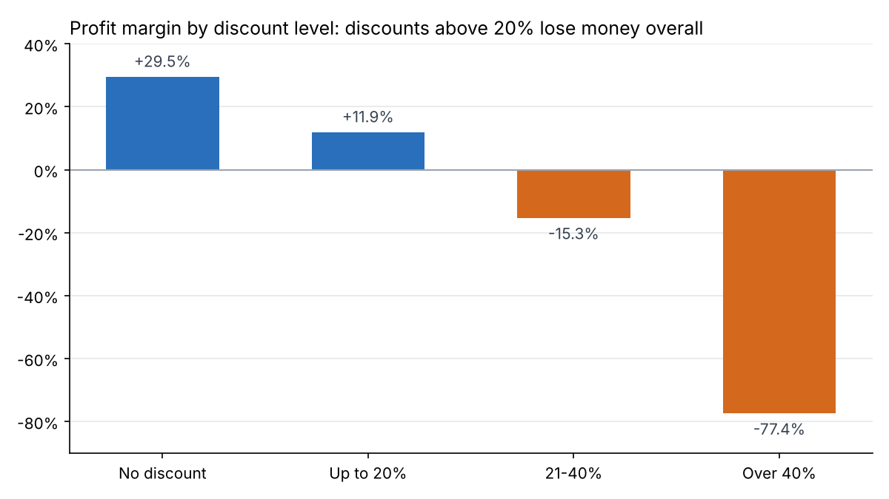
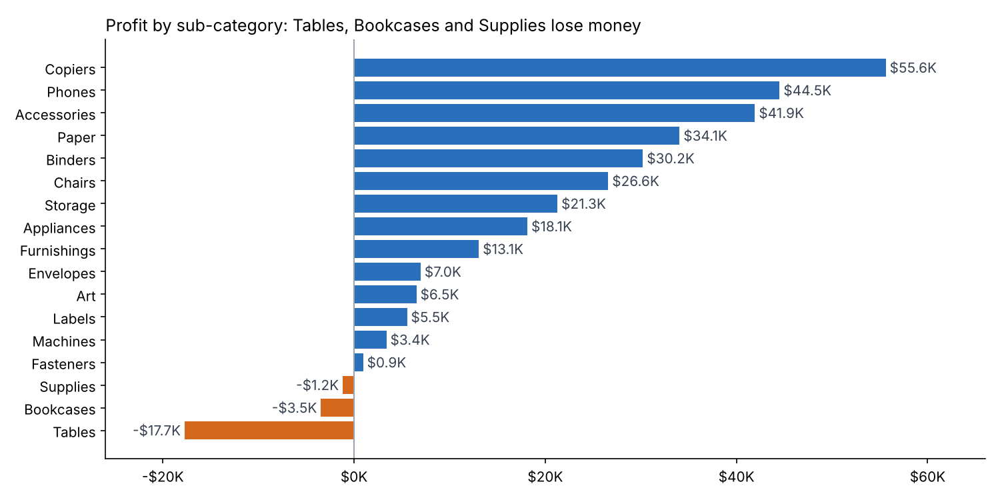
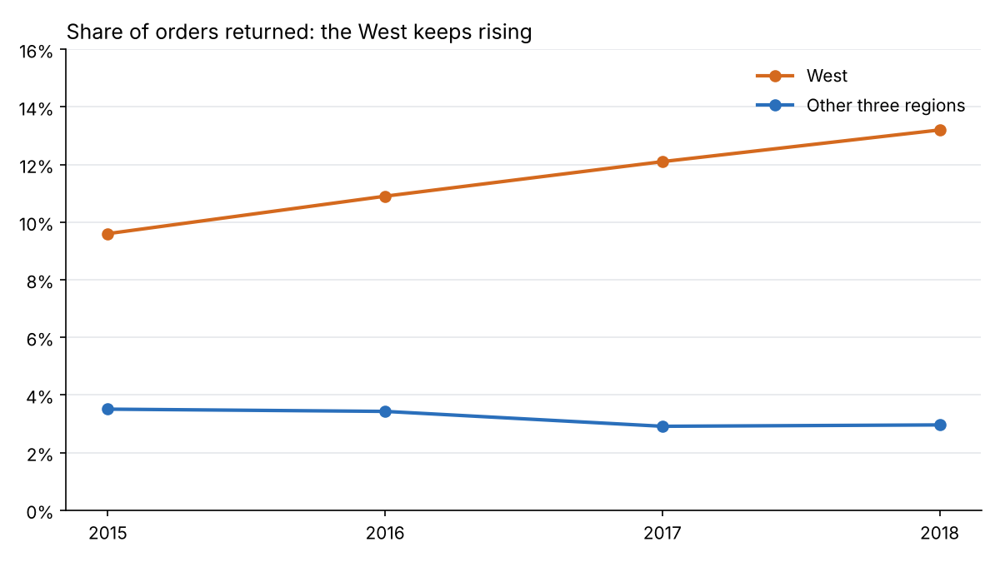
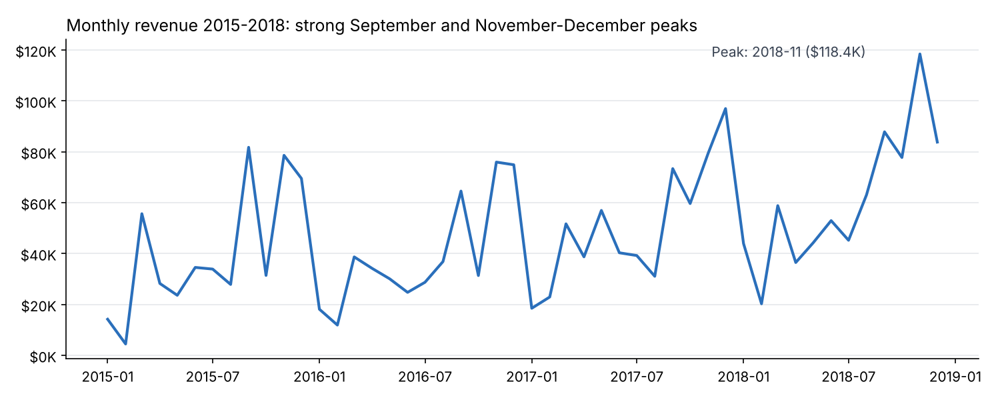

# Retail Sales & Business Performance Analysis

An end-to-end analysis of four years of orders from a fictional US office-supplies retailer, using
**Python (Pandas)**, **SQL (SQLite)**, **Excel** and **Power BI**. The goal is not to make charts, but to find out
*where the business makes money, where it loses it, and what management should do about it.*

> **Data note:** the data is Tableau's *Sample Superstore*, a **fictional** dataset made for learning.
> Findings describe this dataset, not a real company. Source and license details are in [`data/README.md`](data/README.md).

## Headline results

| | |
|---|---|
| Revenue | $2.30M (2015-2018) |
| Profit | $286K (12.5% margin) |
| Orders | 5,009 from 793 customers |
| Average order value | $458.61 |

**The main finding:** the business is profitable overall, but discounts above 20% destroy profit.

| Discount given | Order lines | Profit margin |
|---|---|---|
| None | 4,798 | **+29.5%** |
| Up to 20% | 3,803 | **+11.9%** |
| 21-40% | 460 | **-15.3%** |
| Over 40% | 933 | **-77.4%** |



## Business questions

1. How are revenue and profit trending, and is there seasonality?
2. Which categories, sub-categories and products make or lose money?
3. How do the regions and states compare?
4. How do customers behave: do they come back, and are we dependent on a few?
5. What is causing the losses, and what should management change?

## Project structure

```
retail-sales-analysis/
├── README.md
├── requirements.txt
├── data/
│   ├── README.md                  source, license, how to download
│   └── processed/orders_clean.csv cleaned data (9,994 order lines)
├── notebooks/
│   ├── 01_data_cleaning.ipynb     Pandas: cleaning and validation
│   ├── 02_sql_analysis.ipynb      runs the SQL queries, explains results, makes charts
│   └── 03_excel_report.ipynb      builds the Excel report
├── sql/
│   └── analysis_queries.sql       20 queries (GROUP BY, CASE, window functions, CTE)
└── dashboard/
    ├── Superstore_Excel_Report.xlsx
    ├── POWERBI_BUILD_GUIDE.md     data model, DAX measures, layout, numbers to check
    └── analysis_*.png             charts from notebook 02
```

## How to run

```bash
pip install -r requirements.txt
```

1. Download the raw file (see [`data/README.md`](data/README.md)) and save it as `data/raw/superstore_raw.csv`.
2. Run notebook `01`, then `02`, then `03`. Notebook 01 creates the SQLite database that notebook 02 queries.

## Data cleaning (notebook 01)

| Problem found | Decision |
|---|---|
| The CSV contained 3 sheets stacked together (806 non-order rows) | Split them. Kept the Returns list as a flag on each order, ignored the People sheet |
| Dates stored as text | Converted with an explicit `%m/%d/%Y` format |
| Postal codes had lost leading zeros | Converted back to 5-character text |
| 11 missing postal codes (all Burlington, VT) | Left empty. Not used, and no safe way to fill them |
| 8 repeated Order ID + Product ID pairs | Kept: 7 are split order lines. One pair (rows 3406/3407, about $281 in sales) is identical and may be a duplicate, but I cannot prove it |
| 1,871 negative-profit lines | Kept. They are real losses and the point of the analysis |
| Customer names | Dropped (personal data, not needed). Only Customer ID is kept |

Validation checks: no zero or negative sales or quantity, discounts between 0 and 1, no ship date before order date.

## Insights

Each finding follows the same pattern: what happened, why it may have happened, what to do.
Numbers come from the SQL queries in [`sql/analysis_queries.sql`](sql/analysis_queries.sql).

### 1. Discounts above 20% lose money in every category

**What happened.** Order lines discounted above 20% are 13.9% of all lines and 15.8% of revenue, but they
lost **$135K**. Everything else earned **$422K**. Without those losses, profit would have been 47% higher
($422K instead of $286K).

**Where.** Furniture earns 13.3% margin on lines discounted up to 20% but -27.9% above it. Binders have 613
deep-discount lines (44% of all of them) and lose $38.5K on them, while earning $68.7K on their lighter-discount lines.
Tables, Machines and Bookcases lose $30.7K, $29.6K and $11.1K on deep discounts.

**Why it may have happened.** The data shows *that* deep discounts lose money, not *why* they are given.
Possible reasons: clearance of slow stock, volume deals, or a lack of any discount limit. Management should check.

**It is getting worse.** The share of deep-discount lines is flat (about 14% each year), but the money lost on
them rose from $31.4K in 2017 to $47.6K in 2018 (+52%). This is part of why 2018 revenue grew 20.4% while profit
grew only 14.2% and margin fell from 13.4% to 12.7%.

**Recommendation.** Set an approval rule for discounts above 20% (for example, manager sign-off). Start with
Binders, Tables and Machines. The $135K is an upper bound, not a forecast: some of those sales might not
happen without the discount.



### 2. Furniture sells like a star category but earns almost nothing

**What happened.** Furniture brings 32% of revenue ($742K) but only 6% of profit ($18K, 2.5% margin).
Technology and Office Supplies both earn about 17%. **Tables lose $17.7K** (-8.6% margin, average discount 26.1%)
and Bookcases lose $3.5K.

**Why.** Deep discounts explain a large part: furniture margin on lines discounted up to 20% is a healthy 13.3%.
(Furniture is also bulky, so shipping costs might play a role, but this dataset has no cost data to check that.)

**Recommendation.** Review table pricing and discount policy first. Do not drop the category: its
lighter-discount lines are profitable.

### 3. Central region and ten states are where profit leaks

**What happened.** Central has the lowest margin (7.9% against 11.9-14.9% elsewhere) and the highest average
discount (24.0% against 10.9-14.7%). Ten states lose money in total, led by **Texas (-$25.7K), Ohio (-$17.0K),
Pennsylvania (-$15.6K) and Illinois (-$12.6K)**, about -$98K together. All ten have average discounts of 28-39%,
against 15.6% for the whole company.

**Why.** Discounting follows the same pattern as the losses, which points to a discount-policy problem more
than a demand problem. This is a correlation, not proof.

**Recommendation.** Look at discount practice in Central and the ten states before changing prices or
closing anything. Sales there are healthy (Texas alone has $170K in revenue).

### 4. The West has a return problem that is getting worse

**What happened.** 296 of 5,009 orders (5.9%) were returned. In the **West the rate is 11.7%; in the other
three regions it is about 3%.** The West holds 64% of all returned orders, and its rate rose every year:
9.6% (2015), 10.9%, 12.1%, 13.2% (2018). Returned orders contain $180K of sales (7.9% of revenue).

**Why it may have happened.** The gap is spread across the West's states and categories, so it is not one bad
product. The data has no return reasons. Candidates are fulfilment, carrier or a regional customer-service
practice.

**Recommendation.** Start collecting return reasons and investigate the West before it grows further.
Caveat: the sales in returned orders are an upper limit on revenue at risk, since the data does not say how much was refunded.



### 5. Strong seasonality, so plan for it

**What happened.** September, November and December bring 43% of the average year's revenue (November alone
averages $88K). January and February bring only 6.7%. The largest month in the data is November 2018 ($118K).

**Recommendation.** Plan stock, staff and delivery capacity around the autumn peak, and test promotions in the
weak first quarter instead of discounting in peak months.



### 6. Customers are loyal and not concentrated

Only 12 of 793 customers bought once. 98.5% placed 2 or more orders (6.3 on average over four years), and the top
10% of customers account for 30.6% of revenue. That is healthy, and it means the profit problem is **how we sell,
not who we sell to**. Consumers bring half the revenue (50.6%) at the lowest margin (11.5%), Home Office is the
smallest segment (18.7%) with the best margin (14.0%).

### 7. Top products are not always good products

The top 10 products make up only 10.6% of revenue (no dependence on a few items), but three of them lose money,
including a $22.6K videoconferencing unit sold at 50% average discount. The two Cubify 3D printers lose $12.7K
together at 50-53% average discounts.

## Power BI dashboard

`dashboard/POWERBI_BUILD_GUIDE.md` gives the data model, the DAX measures (Total Revenue, Total Profit, Total Orders,
Average Order Value, Profit Margin %, Return Rate %), page layouts and the numbers to check against.

*Add your dashboard screenshots here once built:*
``

## Limitations

- The data is fictional and a sample. Real-world conclusions should not be drawn from it.
- There are no product costs, shipping costs or return reasons. "Why" statements are hypotheses from the patterns, not proven causes.
- Profit is taken as given in the dataset; I did not recalculate it.
- Returns are known per order, with no refund amounts.
- The discount bands (20%, 40%) are my own choice. The conclusion (deep discounts lose money) holds at other cut-offs,
  but the exact dollar figures change.

## Tools

Python 3.13, pandas, matplotlib, openpyxl, SQLite (included with Python), Excel, Power BI Desktop.
No external APIs or network calls are used by the code.

## Data source

Tableau Sample Superstore (fictional data). See [`data/README.md`](data/README.md).
